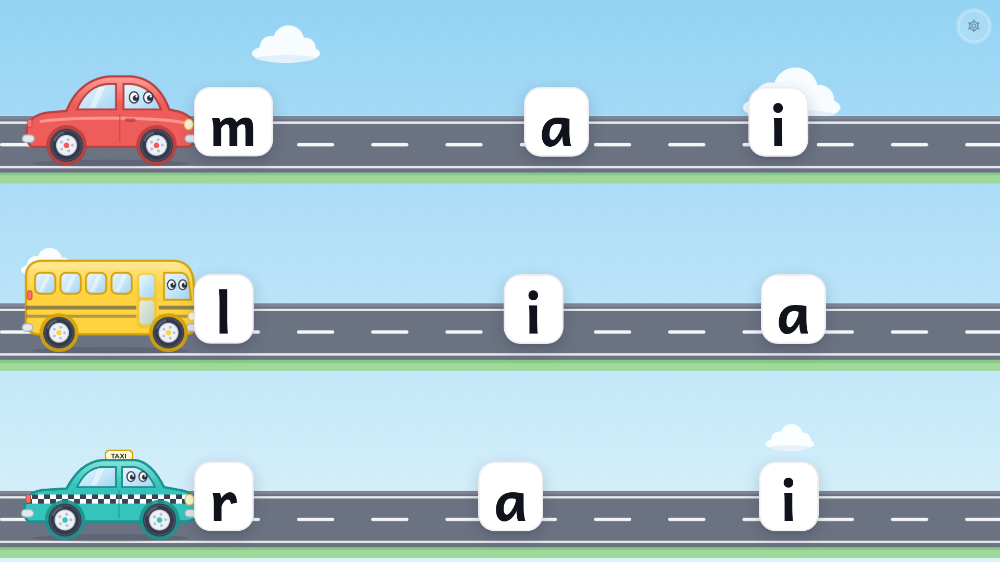

# La Route des Syllabes

Application web pour la classe de CP, inspirée de l'activité allemande « Autolesen ».
Créée par **Willem Vanbaelinghem**.
Sur le grand écran tactile, chaque route porte un véhicule qui transporte une **consonne**.
L'élève fait glisser le véhicule avec le doigt en prolongeant le son (« llllll… »).
Quand la consonne touche une **voyelle**, les deux se collent et forment la syllabe : « la ! ».

- **Mode élève** : plein écran, sans aucun texte à lire. Jusqu'à 4 routes, et un doigt par route.
- **Espace maîtresse** : on prépare des séances (lettres, décor, règles, retours) avec un aperçu en direct.
- **Aucune donnée d'élève** n'est enregistrée (voir [Données personnelles](#données-personnelles-rgpd)).



---

## Sommaire

1. [Lancer la démo en local](#1-lancer-la-démo-en-local)
2. [Déployer sur le VPS, pas à pas](#2-déployer-sur-le-vps-pas-à-pas)
3. [Créer le compte de la maîtresse](#3-créer-le-compte-de-la-maîtresse)
4. [Sauvegarder la base](#4-sauvegarder-la-base)
5. [Passer à un nom de domaine en HTTPS](#5-passer-à-un-nom-de-domaine-en-https)
6. [Utilisation en classe](#6-utilisation-en-classe)
7. [Développement](#7-développement)
8. [Police cursive](#8-police-cursive)
9. [Données personnelles (RGPD)](#données-personnelles-rgpd)

---

## 1. Lancer la démo en local

### Avec Docker (le plus simple)

```bash
cp .env.example .env
# Ouvrez .env et remplacez SESSION_SECRET (par exemple : openssl rand -base64 48)
docker compose up -d --build
docker compose exec app npm run create-user -- --email maitresse@ecole.fr --password "un-mot-de-passe"
```

Ouvrez ensuite <http://localhost:8080>. Le bouton **« Jouer sans compte »** de la page de connexion
lance tout de suite une démonstration, sans même créer de compte.

### Sans Docker (Node.js 20 ou plus)

```bash
npm ci
npm run build
npm run create-user -- --email maitresse@ecole.fr --password "un-mot-de-passe"
SESSION_SECRET="$(openssl rand -base64 48)" PORT=8080 npm start
```

---

## 2. Déployer sur le VPS, pas à pas

Le VPS héberge déjà d'autres services : l'application vit dans **un seul conteneur**, sur un
**port de votre choix** (`APP_PORT`), avec sa base SQLite dans un **volume Docker nommé**.

1. **Se connecter au VPS** et vérifier que Docker est installé :

   ```bash
   ssh utilisateur@IP_DU_VPS
   docker --version && docker compose version
   ```

2. **Récupérer le code** :

   ```bash
   git clone https://github.com/Whiplashhhh/RouteDesSyllabes.git route-des-syllabes
   cd route-des-syllabes
   ```

3. **Configurer** :

   ```bash
   cp .env.example .env
   nano .env
   ```

   - `APP_PORT` : un port libre sur le VPS (vérifiez avec `ss -tlnp | grep :8080`).
   - `SESSION_SECRET` : collez le résultat de `openssl rand -base64 48`.
   - Laissez `COOKIE_SECURE=false` tant que l'accès se fait en `http://IP:PORT`.

4. **Construire et démarrer** :

   ```bash
   docker compose up -d --build
   docker compose ps            # l'état doit passer à « healthy »
   ```

5. **Ouvrir le port** dans le pare-feu si besoin (exemple avec `ufw`) :

   ```bash
   sudo ufw allow 8080/tcp
   ```

6. **Créer le compte de la maîtresse** (voir la section suivante), puis ouvrir `http://IP_DU_VPS:8080`.

**Mettre à jour** plus tard : `git pull && docker compose up -d --build`. Les données sont conservées
dans le volume.

> ⚠️ **En HTTP simple (`http://IP:PORT`), le mot de passe circule en clair sur le réseau.**
> C'est acceptable pour une première démonstration, mais passez en HTTPS dès que possible
> (section 5). Choisissez en attendant un mot de passe que vous n'utilisez nulle part ailleurs.

---

## 3. Créer le compte de la maîtresse

Les inscriptions sont fermées par défaut (`ALLOW_SIGNUP=false`). Les comptes se créent en ligne de
commande, ce qui ajoute automatiquement **quatre séances d'exemple** (progression classique de CP) :

```bash
docker compose exec app npm run create-user -- --email maitresse@ecole.fr --password "son-mot-de-passe"
```

Mot de passe oublié ? On en définit un nouveau (toutes les sessions ouvertes sont fermées) :

```bash
docker compose exec app npm run reset-password -- --email maitresse@ecole.fr --password "nouveau-mot-de-passe"
```

Seule règle pour le mot de passe : au moins 8 caractères. Il est stocké haché avec **argon2id**.

---

## 4. Sauvegarder la base

Toutes les données tiennent dans un seul fichier SQLite, dans le volume `donnees` (`/data` dans le
conteneur). Une commande suffit pour en faire une copie cohérente, même pendant l'utilisation :

```bash
docker compose exec app node -e "require('better-sqlite3')('/data/route-des-syllabes.sqlite').backup('/data/sauvegarde.sqlite').then(()=>console.log('ok'))" \
  && docker compose cp app:/data/sauvegarde.sqlite "./sauvegarde-$(date +%F).sqlite"
```

Pour **restaurer** une sauvegarde :

```bash
docker compose stop app
docker compose cp ./sauvegarde-AAAA-MM-JJ.sqlite app:/data/route-des-syllabes.sqlite
docker compose start app
```

Astuce : ajoutez la première commande dans une tâche `cron` quotidienne.

---

## 5. Passer à un nom de domaine en HTTPS

Une fois un nom de domaine pointé vers le VPS (ex. `syllabes.mon-ecole.fr`), placez l'application
derrière un reverse proxy qui gère le certificat, puis dans `.env` :

```ini
COOKIE_SECURE=true   # le cookie de session ne circule plus qu'en HTTPS
TRUST_PROXY=true     # pour connaître la vraie IP des visiteurs (limitation des tentatives)
```

et redémarrez : `docker compose up -d`.

Si le proxy tourne sur la même machine, n'exposez le port qu'en local en ajoutant `APP_BIND=127.0.0.1`
dans `.env`.

Sans nom de domaine, un sous-domaine [sslip.io](https://sslip.io) qui contient l'IP du VPS
(ex. `syllabes.203-0-113-10.sslip.io`) permet aussi d'obtenir un certificat Let's Encrypt.

### Avec Caddy (certificat automatique)

```caddy
syllabes.mon-ecole.fr {
    encode zstd gzip
    reverse_proxy 127.0.0.1:8080
}
```

### Avec Nginx (+ Certbot)

```nginx
server {
    listen 80;
    server_name syllabes.mon-ecole.fr;
    return 301 https://$host$request_uri;
}

server {
    listen 443 ssl http2;
    server_name syllabes.mon-ecole.fr;

    ssl_certificate     /etc/letsencrypt/live/syllabes.mon-ecole.fr/fullchain.pem;
    ssl_certificate_key /etc/letsencrypt/live/syllabes.mon-ecole.fr/privkey.pem;

    location / {
        proxy_pass http://127.0.0.1:8080;
        proxy_set_header Host $host;
        proxy_set_header X-Forwarded-For $proxy_add_x_forwarded_for;
        proxy_set_header X-Forwarded-Proto $scheme;
        proxy_set_header X-Forwarded-Host $host;
    }
}
```

Le certificat s'obtient avec `sudo certbot --nginx -d syllabes.mon-ecole.fr`.
Pensez à transmettre l'en-tête `Host` (ou `X-Forwarded-Host`) : le serveur vérifie que les requêtes
qui modifient des données viennent bien du même site.

---

## 6. Utilisation en classe

1. Sur l'écran de la classe (Chrome), connectez-vous et appuyez sur **▶ Jouer** : le jeu passe en
   plein écran.
2. Les enfants font glisser les véhicules. Rien d'autre n'est cliquable pour eux.
3. Pour la maîtresse : **maintenir le doigt environ 1,5 seconde** sur le petit rond discret en haut à
   droite. Un anneau se remplit, puis le panneau s'ouvre : _Nouvelles lettres_, _Remettre au départ_,
   _Séance suivante_, _Choisir une séance_, _Quitter_.
4. Au clavier : **→** pour de nouvelles lettres, **Échap** pour le panneau, **Début** pour remettre au
   départ.

---

## 7. Développement

| Commande                          | Rôle                                                    |
| --------------------------------- | ------------------------------------------------------- |
| `npm run dev`                     | client Vite (port 5173) et serveur Fastify (port 3000)  |
| `npm run lint` / `npm run format` | ESLint et Prettier                                      |
| `npm run typecheck`               | vérification TypeScript (client et serveur)             |
| `npm test`                        | tests unitaires et tests d'API (Vitest)                 |
| `npm run test:e2e`                | tests de bout en bout (Playwright, build de production) |
| `npm run screenshots`             | captures d'écran dans `docs/screenshots/`               |

En développement, créez un compte avec
`npm run create-user:dev --workspace server -- --email ... --password ...`.

Organisation du dépôt :

```
client/   React 18 + TypeScript + Vite : jeu (src/game) et espace maîtresse (src/pages)
server/   Fastify + SQLite (better-sqlite3), migrations, authentification, CLI
shared/   modèle d'une séance, catalogues et tirage des lettres (sans dépendance)
e2e/      tests Playwright et script de captures
```

Conventions : [Conventional Commits](https://www.conventionalcommits.org/fr/), une branche et une
pull request par fonctionnalité, intégration continue GitHub Actions (format, lint, types, tests,
build, tests de bout en bout, construction et démarrage de l'image Docker).

---

## 8. Police cursive

Dans l'éditeur, **Règles → Écriture des lettres** propose trois choix : minuscules, majuscules ou
**cursive**. La cursive utilise [Playwrite FR Trad](https://fonts.google.com/specimen/Playwrite+FR+Trad)
(licence OFL), cursive scolaire française à boucles, auto-hébergée via `@fontsource/playwrite-fr-trad`.
En cursive, quand la consonne touche la voyelle, la syllabe s'écrit d'un seul trait (lettres liées).

Pour changer de police cursive, modifiez l'entrée `cursive` de `client/src/game/polices.ts` et
l'import correspondant dans `client/src/main.tsx`. En démo : `/demo?cursive=1`.

---

## Données personnelles (RGPD)

L'application **ne stocke aucune donnée sur les élèves** : pas de nom, pas de score, pas de
statistiques, pas de traceur. La base contient uniquement le compte de la maîtresse (email et mot de
passe haché) et ses séances. Aucun service extérieur n'est appelé : les polices sont auto-hébergées,
les sons sont générés dans le navigateur et la voix utilise la synthèse vocale de l'appareil.

## Licences

Code : [licence MIT](LICENSE), © 2026 Willem Vanbaelinghem.

Polices : [Andika](https://software.sil.org/andika/) (SIL), Nunito et Fredoka, toutes sous licence
SIL Open Font License, fournies par Fontsource.

## Crédits

Conception et développement : **Willem Vanbaelinghem**.
